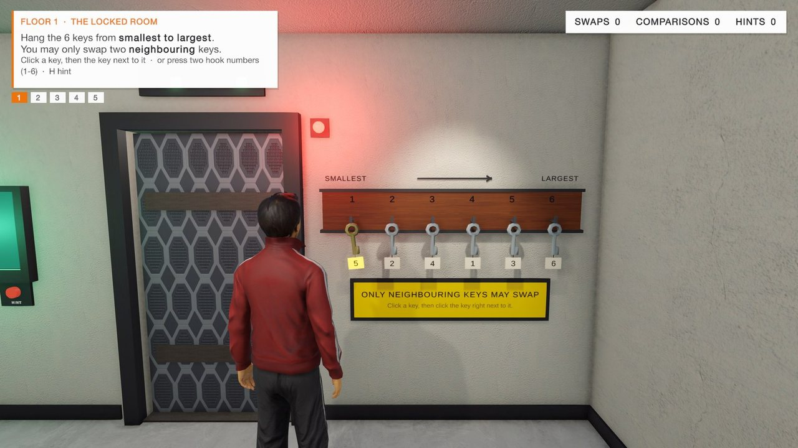
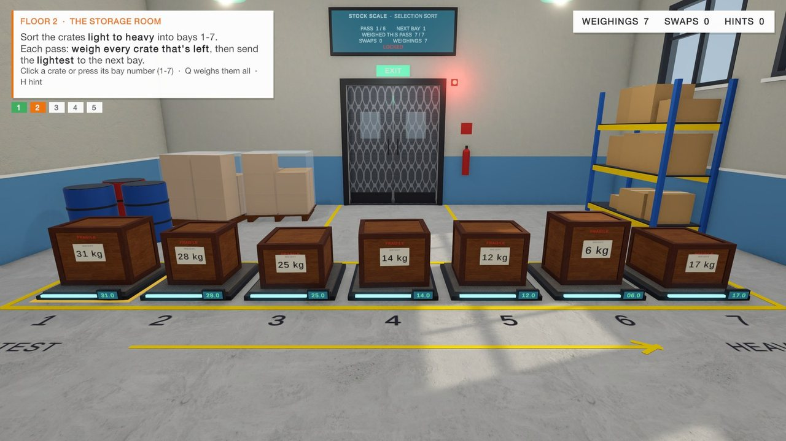
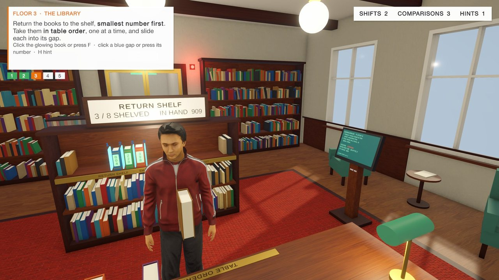
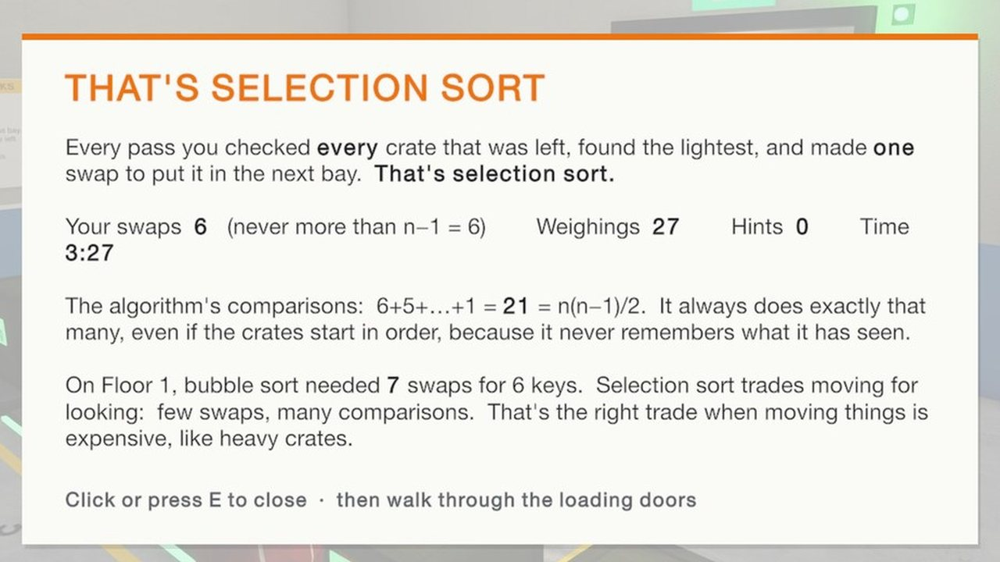
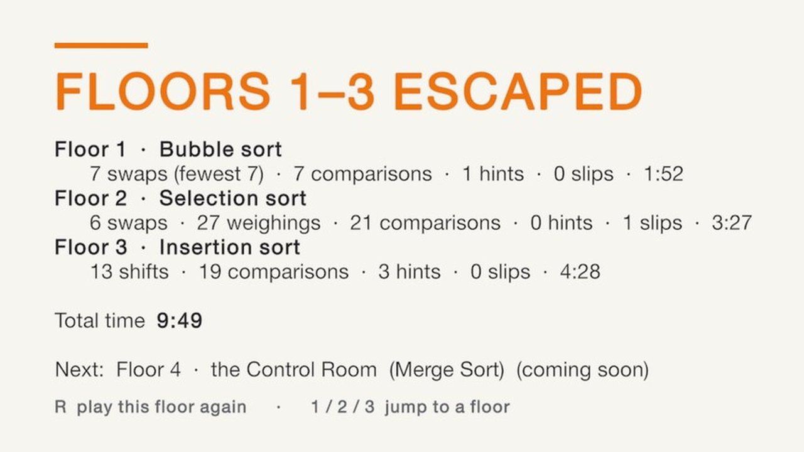

# Sort or Stay

**A 3D escape-room game where you learn sorting algorithms by sorting real objects — or stay locked in.**

GDIT game project · Group 3 · IIIT Sri City · built with Unity 6



You wake up locked in a five-floor building. Every floor is a room whose exit opens only when its objects are in order, and the room's rule *is* the algorithm: on Floor 1 only neighbouring keys may swap (bubble sort), on Floor 2 crate weights stay hidden until you weigh them (selection sort), on Floor 3 books arrive one by one and must be slid into the shelf (insertion sort). Every move is checked; a wrong move gets a reason, and after each floor a debrief compares your moves with the fewest possible.

## Floors

| Floor | Room | Algorithm | How it plays | Status |
|---|---|---|---|---|
| 1 | Locked Room | Bubble sort | 6 numbered keys on hooks; only neighbours may swap | Built |
| 2 | Storage Room | Selection sort | 7 crates with hidden weights; weigh every crate left, a crane moves the lightest to the next bay | Built |
| 3 | Library | Insertion sort | 8 books taken in table order and slid into numbered shelf gaps; bigger books shift right | Built |
| 4 | Control Room | Merge sort | — | Next |
| 5 | Vault | Quick sort | — | Planned |

| Floor 2 – Storage Room | Floor 3 – Library |
|---|---|
|  |  |
| **Debrief after a floor** | **End scoreboard** |
|  |  |

## Team — Group 3

| Member | Roll No. | Contribution |
|---|---|---|
| Premkumar Thota | S20240010243 | Floor 1 · Locked Room (bubble sort); Floor 4 · Control Room (merge sort); player avatars & controls |
| Vijaya Teja Kameswar | S20240010048 | Floor 2 · Storage Room (selection sort); Floor 5 · Vault (quick sort) |
| Uday Banu Prakash | S20240010009 | Floor 3 · Library (insertion sort); debrief cards & scoreboard; pilot study |

## Open the project

1. Install **Unity 6000.6.2f1** (Unity 6.6) with Unity Hub.
2. Clone this repo and add the folder in Unity Hub (*Add → Add project from disk*).
3. The first open re-imports all assets and rebuilds `Library/` (a few minutes).
4. Open `Assets/SortOrStay/Scenes/Level1_Bubble.unity` and press **Play**. Floors 2 and 3 load from the door/stairwell or from the pause menu.

Render pipeline: URP (Forward+), linear colour space, new Input System.

## Controls

| Input | Action |
|---|---|
| Left click | Point and click (default): use the highlighted object — the avatar walks over by itself; click the floor to walk |
| Right-drag / arrow keys | Turn the camera |
| Scroll | Zoom |
| WASD | Walk |
| Space | Jump |
| Number keys | Floor 1: pick the key on that hook · Floor 2: use the crate on that bay · Floor 3: slide the book into that gap |
| F | Floor 3: fetch the next book |
| Q | Floor 2: weigh all remaining crates |
| H | Hint |
| V | First / third person |
| C | Switch character (Alex / Maya) |
| Tab | Switch to mouse-look (crosshair) controls |
| Esc | Pause menu (restart, jump to a floor, camera, controls) |
| K | *Editor only:* save a Game-view screenshot to `Screenshots/` |

## Editor tools

Menu **Sort or Stay** in the Unity editor:

- **Build Level 1 / 2 / 3** — rebuilds each floor's scene from code (`Assets/SortOrStay/Editor/BuildLevel*.cs`, shared parts in `Kit.cs`).
- **Setup Player Characters** — re-applies the Rocketbox import settings and rebuilds the avatar materials and Animator controllers.
- **Build Basic Demo (Level 1 Bubble Sort)** — a minimal fixed-camera bubble-sort room.
- **Capture Game Screenshot** — same as **K** in Play mode.

## Project layout

```
Assets/
  SortOrStay/
    Scripts/      gameplay: puzzles (Bubble/Selection/InsertionPuzzle), player, interactor, HUD, doors, level manager
    Editor/       scene builders and import tools
    Scenes/       Level1_Bubble, Level2_Selection, Level3_Insertion
    BasicDemo/    stand-alone basic bubble-sort demo
    Materials/ Player/ Settings/
  ThirdParty/
    Rocketbox/    realistic human avatars + animations (Microsoft, MIT)
    SortOrStay/   CC0 model packs (KayKit, Kenney) and ambientCG textures
Docs/             project presentation (PPTX + PDF) and screenshots
Packages/ ProjectSettings/
```

## Presentation

The GDIT project presentation (motivation, problem, state of the art, research gap, game design, gameplay loop, progress) is in [`Docs/Sort_or_Stay_GDIT_Presentation.pdf`](Docs/Sort_or_Stay_GDIT_Presentation.pdf) ([PowerPoint](Docs/Sort_or_Stay_GDIT_Presentation.pptx)).

## Credits

- [Microsoft Rocketbox Avatar Library](https://github.com/microsoft/Microsoft-Rocketbox) — MIT licence (`Assets/ThirdParty/Rocketbox/LICENSE.md`)
- [KayKit](https://kaylousberg.com/game-assets) Dungeon Remastered, Furniture Bits, Prototype Bits — CC0
- [Kenney](https://kenney.nl) Space Station Kit, Conveyor Kit — CC0
- [ambientCG](https://ambientcg.com) PBR textures — CC0

Each pack keeps its own licence file inside `Assets/ThirdParty/`.
