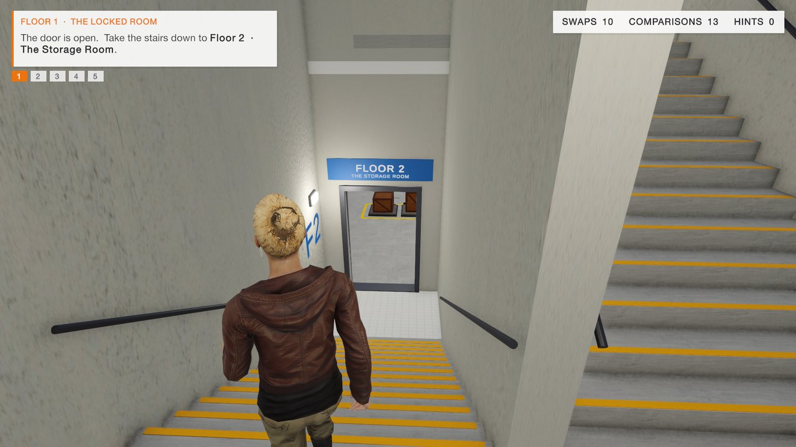

# Sort or Stay

**A 3D escape-room game where you learn sorting algorithms by sorting real objects — or stay locked in.**

GDIT game project · Group 3 · IIIT Sri City · built with Unity 6


You wake up locked on the top floor of a five-floor building and have to sort your way down to the street. Every floor is a room whose exit opens only when its objects are in order, and the room's rule *is* the algorithm: on Floor 1 only neighbouring keys may swap (bubble sort), on Floor 2 crate weights stay hidden until you weigh them (selection sort), on Floor 3 the books on the shelf are sorted in place, each one walked left past bigger books (insertion sort), on Floor 4 the data blocks are split apart and merged back two runs at a time (merge sort), and on Floor 5 the gold bars are split around a pivot behind a laser gate (quick sort). Every move is checked; a wrong move gets a reason, and after each floor a debrief compares your moves with the fewest possible.

## The building

The whole game is one continuous scene, `Scenes/Building.unity`: five rooms stacked on top of each other with a stair tower on the front. There are no loading screens or black fades between floors.

1. Sort the room. The exit door unlocks and swings open onto the stair landing.
2. Walk down: a flight of stairs to the half-landing (window, sign to the next floor), then a second flight back to the next floor's doorway.
3. Walk in. The doorway slides shut behind you, the HUD switches to the new floor (title, objective, counters, number keys) and that floor's clock starts.
4. On the ground floor the vault door opens into a corridor under the stairs. Walk out through the street door to finish: the scoreboard of all five floors appears.

A wall between the two flights keeps every floor's exit landing separate from the stairs coming down, so the only way down is through every room. Floor 1 (the Locked Room) is the top storey and Floor 5 (the Final Vault) the ground floor.



## Floors

| Floor | Room | Algorithm | How it plays | Status |
|---|---|---|---|---|
| 1 | Locked Room | Bubble sort | 6 numbered keys on hooks; only neighbours may swap | Built |
| 2 | Storage Room | Selection sort | 7 crates with hidden weights; weigh every crate left, a crane moves the lightest to the next bay | Built |
| 3 | Library | Insertion sort | 8 books start on the shelf out of order; pull a book out, shift bigger books right, place it | Built |
| 4 | Control Room | Merge sort | 8 data blocks on a merge console; SPLIT halves every run until each block stands alone, then two runs merge at a time by taking the smaller front block into the merge row | Built |
| 5 | Final Vault | Quick sort | 8 gold bars on a marble counter; raise the pivot (last bar), send each smaller bar behind the laser gate, drop the pivot into its final slot, repeat on each side; the vault door opens on a sorted row | Built |

| Floor 2 – Storage Room | Floor 3 – Library |
|---|---|
|  |  |
| **Debrief after a floor** | **End scoreboard** |
|  |  |

## Team — Group 3

| Member | Roll No. | Contribution |
|---|---|---|
| Premkumar Thota | S20240010243 | Floor 1 · Locked Room (bubble sort); Floor 4 · Control Room (merge sort); player avatars & controls |
| Vijaya Teja Kameswar | S20240010048 | Floor 2 · Storage Room (selection sort); Floor 5 · Vault (quick sort) |
| Uday Banu Prakash | S20240010009 | Floor 3 · Library (insertion sort); debrief cards & scoreboard; pilot study |

## Open the project

1. Install **Unity 6000.6.2f1** (Unity 6.6) with Unity Hub.
2. Clone this repo and add the folder in Unity Hub (*Add → Add project from disk*).
3. The first open re-imports all assets and rebuilds `Library/` (a few minutes).
4. Open `Assets/SortOrStay/Scenes/Building.unity` and press **Play**: you wake up on the top floor. The pause menu (Esc) restarts the floor you are on or starts the building on another floor; after the street door the end card shows the scoreboard of every floor.
5. Each floor also has its own scene (`Level1_Bubble` … `Level5_Quick`) for working on one room; those still link floor to floor by loading the next scene.

Render pipeline: URP (Forward+), linear colour space, new Input System.

## Controls

| Input | Action |
|---|---|
| Left click | Point and click (default): use the highlighted object — the avatar walks over by itself; click the floor to walk |
| Right-drag / arrow keys | Turn the camera |
| Scroll | Zoom |
| WASD | Walk |
| Space | Jump |
| Number keys | Floor 1: pick the key on that hook · Floor 2: use the crate on that bay · Floor 3: use the book (or glowing spot) at that shelf position · Floor 4: 1 / 2 take the left / right front block · Floor 5: 1 smaller, 2 bigger than the pivot |
| F | Floor 3: pull out the next book |
| Q | Floor 2: weigh all remaining crates · Floor 4: split every run in half |
| P | Floor 5: raise the pivot / drop it into its slot |
| H | Hint |
| V | First / third person |
| C | Switch character (Alex / Maya) |
| Tab | Switch to mouse-look (crosshair) controls |
| Esc | Pause menu (restart this floor, start on another floor, camera, controls) |
| K | *Editor only:* save a Game-view screenshot to `Screenshots/` |

## Editor tools

Menu **Sort or Stay** in the Unity editor:

- **Build Building (all 5 floors)** — builds `Building.unity`: the five floor rooms stacked into one building, the stair tower, the exit corridor and the street (`BuildBuilding.cs`). Runtime: `BuildingManager.cs` (which floor is current, HUD, lights, restart) and `EntranceDoor.cs`.
- **Build Level 1 / 2 / 3 / 4 / 5**, **Build Levels 4 + 5** — rebuilds each floor's own scene from code (`Assets/SortOrStay/Editor/BuildLevel*.cs`, shared parts in `Kit.cs`). The building uses the same room builders, so a change to a room shows up in both after a rebuild.
- **Dev: Auto-play the building (top to street)** / **… from Floor 4** / **Dev: Hands-on test the building** — play the whole building: every floor is solved, then the avatar walks out of the door, down both flights and into the next floor, and finally out to the street.
- **Dev: Auto-play Floors 4 and 5** / **Dev: Hands-on test Floors 4 and 5** — editor-only play-testers. Auto-play takes the next correct step every half second; the hands-on test walks the avatar over and clicks like a player, with deliberate wrong moves and hints. Both log every step and the debrief to `Logs/SortOrStay_autoplay.txt` and save screenshots to `Screenshots/`. In the editor, Ctrl+N also performs the next correct step on any floor.
- **Setup Player Characters** — re-applies the Rocketbox import settings and rebuilds the avatar materials and Animator controllers.
- **Build Basic Demo (Level 1 Bubble Sort)** — a minimal fixed-camera bubble-sort room.
- **Capture Game Screenshot** — same as **K** in Play mode.

## Project layout

```
Assets/
  SortOrStay/
    Scripts/      gameplay: puzzles (Bubble/Selection/Insertion/Merge/QuickPuzzle), player, interactor, HUD, doors, building and level managers
    Editor/       scene builders and import tools
    Scenes/       Building (the whole game), Level1_Bubble, Level2_Selection, Level3_Insertion, Level4_Merge, Level5_Quick
    BasicDemo/    stand-alone basic bubble-sort demo
    Materials/ Player/ Settings/
  ThirdParty/
    Rocketbox/    realistic human avatars + animations (Microsoft, MIT)
    SortOrStay/   CC0 model packs (KayKit, Kenney) and ambientCG textures
Docs/             project presentation (PPTX + PDF) and screenshots
Packages/ ProjectSettings/
```

## Presentation

The GDIT project presentation (motivation, problem, state of the art, research gap, game design, gameplay loop, progress) is in [`Docs/Sort_or_Stay_GDIT_Presentation.pdf`](Docs/Sort_or_Stay_GDIT_Presentation.pdf) ([PowerPoint](Docs/Sort_or_Stay_GDIT_Presentation.pptx)).

## Credits

- [Microsoft Rocketbox Avatar Library](https://github.com/microsoft/Microsoft-Rocketbox) — MIT licence (`Assets/ThirdParty/Rocketbox/LICENSE.md`)
- [KayKit](https://kaylousberg.com/game-assets) Dungeon Remastered, Furniture Bits, Prototype Bits — CC0
- [Kenney](https://kenney.nl) Space Station Kit, Conveyor Kit — CC0
- [ambientCG](https://ambientcg.com) PBR textures — CC0

Each pack keeps its own licence file inside `Assets/ThirdParty/`.
